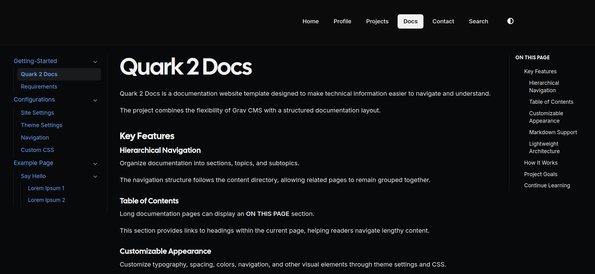

# Quark 2 Docs
 
A child theme of [Quark 2](https://github.com/getgrav/grav-theme-quark2) for [Grav CMS](https://getgrav.org) that adds a **documentation layout**: a collapsible sidebar on the left, the article in the middle, and an automatically generated "On this page" table of contents on the right.
 
Everything else on your site keeps the Quark 2 look. Only pages that use the `docs` template get the documentation layout, so you can run a normal site with Default and Modular pages and a docs section side by side.



## Features
 
- **Documentation sidebar** that lists every page under a root route (default `/docs`), nested to any depth.
- **Collapsible sections.** The current page and its parents open automatically, and a chevron button expands or collapses the rest.
- **Remembers open sections** while browsing the docs (per browser session).
- **"On this page" table of contents** built from the `h2`, `h3` and `h4` headings of the article. It only appears on child pages, not on the docs landing page or main topic pages, and hides itself when a page has no headings.
- **Doc pages can stay out of the main menu.** The sidebar can include pages that are not visible, so you can keep them out of your top navigation.
- **Responsive.** On small screens the sidebar stacks above the article.
- **Light and dark mode** inherited from Quark 2.
- **Admin options** for the docs root, sidebar width, table of contents, hidden pages and sidebar memory.
- All Quark 2 options (theme mode, accent color, header, logo, footer, Font Awesome) still work.

## Requirements
 
- Grav 2.0 or later
- The [Quark 2](https://github.com/getgrav/grav-theme-quark2) theme installed. This theme inherits its templates, styles and scripts from it.

## Creating a documentation section
 
1. Create a folder for the docs, for example `user/pages/05.docs/`, and add a page to it named **`docs.md`**. Pages named `docs.md` use the documentation template automatically:

> [!NOTE]  
> You can create folder without numeric prefix, for example `user/pages/docs`, adding numeric prefix is useful for manual ordering.

```markdown
---
title: Docs
---
 
# Documentation
 
Welcome.
```

2. Add topics as child folders, each with its own `docs.md`:
```
   user/pages/05.docs/
     docs.md
     01.getting-started/
       docs.md
       01.installation/
         docs.md
     02.configuration/
       docs.md
```
 
   Number prefixes control the order in the sidebar.
 
3. If you prefer a different file name, set the template in the page's front matter instead:
```yaml
---
title: Getting Started
template: docs
---
```
 
   Every page that should show the sidebar needs to use the `docs` template, either through the file name or through this setting.

### Keeping doc pages out of the main menu
 
Pages with a number prefix show up in the site navigation. To hide the a docs page from the top menu while keeping them in the sidebar, use `visible` in the docs landing page:
 
```yaml
---
title: Docs
visible: false
---
```
 
Make sure **Include non-visible pages in sidebar** is enabled (it is by default), otherwise hidden pages will not be listed in the sidebar. Valid values are `true` or `false`.


### Set doc menu landing page

By design, side navigation will not be visible in the root doc page. You can redirect doc menu to a landing page by using `redirect`.
```yaml
---
title: Docs
redirect: /docs/getting-started
---
```

> [!TIP]  
> You can also append a redirect code to a URL by using square brackets:  
> `redirect: /docs/getting-started[301]`

Make sure `visible` is not set to `false` so that your doc still appear in main(top) navigation menu.


## Configuration
 
Open the admin, go to **Themes**, select **Quark 2 Docs**, and find the **Documentation layout** section. The same values can be set in `user/config/themes/quark2-docs.yaml`.
 
| Option | Default | Description |
| --- | --- | --- |
| `docs.root` | `/docs` | Route of the page whose children appear in the sidebar. |
| `docs.include_hidden` | `true` | List pages that are not visible (no number prefix, or `visible: false`) in the sidebar. |
| `docs.show_toc` | `true` | Show the "On this page" table of contents on child pages. |
| `docs.remember_state` | `true` | Remember which sidebar sections are expanded during the browser session. |
| `docs.sidebar_width` | `250` | Width of the sidebar in pixels (180 to 400). |
 
Example `user/config/themes/quark2-docs.yaml`:
 
```yaml
docs:
  root: /manual
  include_hidden: true
  show_toc: true
  remember_state: true
  sidebar_width: 280
```
 
All other options (theme mode, accent color, header, logos, favicon, footer, blog route and Font Awesome) are inherited from Quark 2 and documented in its repository.


## Customizing
 
Put your own CSS in `css/custom.css`. The documentation layout uses these classes, which you can override:
 
- `.docs-layout`, `.docs-sidebar`, `.docs-content`, `.docs-toc`
- `.docs-nav-list`, `.docs-nav-item`, `.docs-nav-row`, `.docs-toggle`, `.docs-subnav`
The sidebar width is controlled by the CSS variable `--docs-sidebar-width`.
 
To change the markup, copy `templates/docs.html.twig` into your own child theme and edit it there, so theme updates do not overwrite your changes.


## Troubleshooting
 
- **Pages do not show the sidebar.** Check that the file is named `docs.md` or has `template: docs` in its front matter, then run `bin/grav clearcache`.
- **The sidebar is empty.** Check that `docs.root` matches the route of your docs landing page. The route is the folder name without its number prefix, for example `05.docs` becomes `/docs`.
- **Some pages are missing from the sidebar.** Make sure **Include non-visible pages in sidebar** is enabled, and that the pages are published.
- **Page content shows `&#039;` or other HTML entities in config files.** Re-save the file as plain text. YAML needs normal quote characters.

 

## Credits and license
 
Quark 2 Docs is a child theme of [Quark 2](https://github.com/getgrav/grav-theme-quark2) by Team Grav, which is released under the MIT license.
 
Released under the [MIT License](LICENSE). Copyright (c) Team Grav for the original Quark 2 code and FaizalRefendi for the additions in this theme.
 
